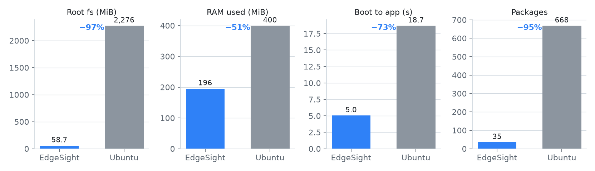
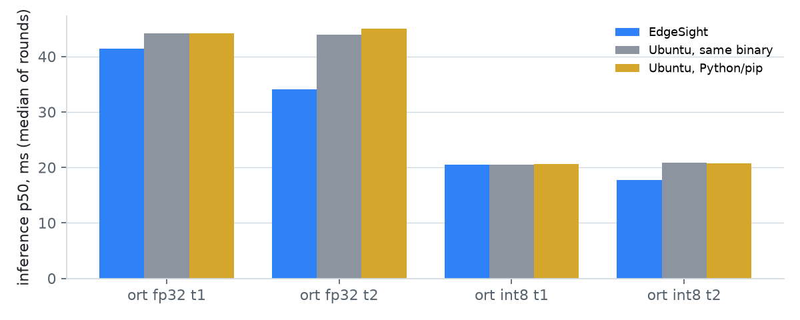
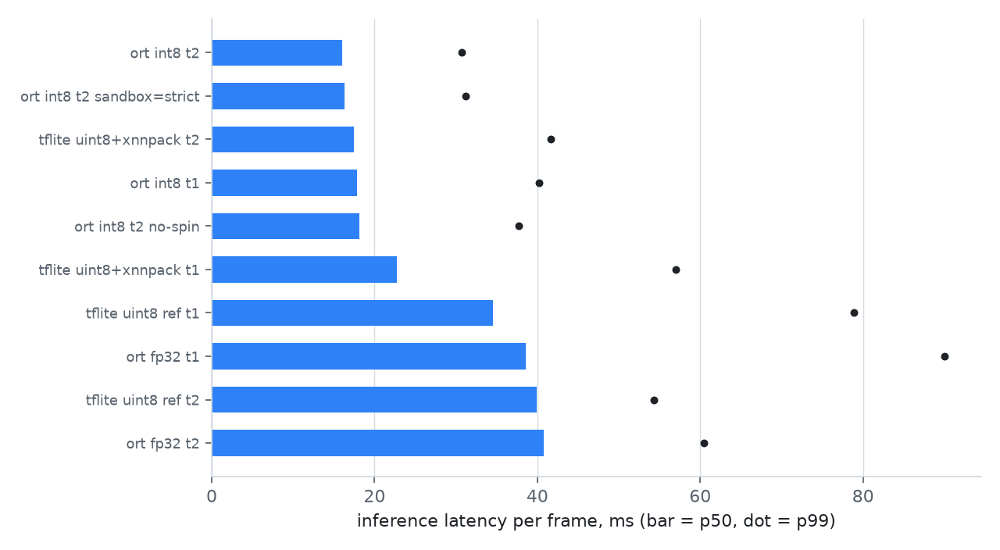

# EdgeSight Linux: an application-specific distribution for edge ML inference

**Track A: ML inference at the edge** · x86-64 (QEMU q35 + KVM, UEFI) · Buildroot 2026.02.3 LTS · Linux 6.12.47 LTS

> EdgeSight is a ~59 MiB, read-only, dm-verity-verified Linux image. It boots straight into a
> sandboxed real-time object-detection service (ONNX Runtime or TensorFlow Lite, SSD-MobileNet-v1
> COCO). The service streams an annotated video dashboard over HTTP and publishes detections over
> MQTT. The only way to change a deployed device is a signed A/B update that rolls itself back if
> the new version fails its health check.

### Results at a glance (EdgeSight vs Ubuntu Server 24.04, identical VM)

| | EdgeSight | Ubuntu 24.04 | |
|---|---:|---:|---:|
| Root file system | **58.7 MiB** | 2 275.5 MiB | −97.4 % |
| Kernel + initrd + modules | **3.6 MiB**, 0 modules | 72.1 MiB, 1 011 modules | −95.1 % |
| Packages | **35** | 668 | −94.8 % |
| RAM used with the detector running | **196 MiB** | 400 MiB | −51 % |
| Power-on → detecting | **5.1 s** | 18.7 s | −73 % |
| Kernel start → detecting | **2.9 s** (best 1.6 s) | 14.9 s | −80 % |
| INT8 detector, 2 threads (interleaved A/B) | **44.0 FPS** | 39.7 (same binary) · 35.0 (Python/pip) | +11 % · +26 % |
| kernel-hardening-checker | **203 OK / 57 FAIL** | 127 OK / 133 FAIL | |
| setuid files · shell/SSH · writable root | **0 · none · no** | 20 · yes · yes | |
| Reproducible from scratch | **disk.img bit-identical** | – | |

Also demonstrated:
- signed A/B OTA with tampered/rogue-bundle rejection and automatic rollback;
- dm-verity tamper detection with slot fallback;
- 7/7 sandbox escape probes blocked;
- CPU isolation halving p99 under load (−49 %).

All numbers in this report come from scripts in the repository and their raw output files.
`bench/report.py` regenerates [results.md](results.md) and the charts in `docs/img/`. §7 lists
every command.

---

## 1. Requirements analysis

### 1.1 Target platform

The image targets an x86-64 edge box in the class of an Intel N100 / Core Ultra-U mini-PC,
emulated with QEMU so the whole project runs on a laptop. A physical x86-64 box would run the same
image unchanged: OVMF stands in for its UEFI firmware, and virtio for its NVMe and NIC drivers.

| Resource | Requirement | Design consequence |
|---|---|---|
| CPU | x86-64-v3 (AVX2, FMA, BMI2), 2 cores | Bootlin x86-64-v3 toolchain; inference on CPU (MLAS / XNNPACK SIMD kernels) |
| GPU / NPU | none (CPU inference) | no GPU stack; CMA reserve configured (size 0) as the hook for a future DMA-capable NPU |
| RAM | 1 GiB total, service + OS ≤ 25 % | met: 196 MiB used = 19 % (§7.2) |
| Storage | ≤ 512 MiB device, A/B slots | two 160 MiB root slots, 160 MiB data |
| Camera | MJPEG stream (USB-UVC/IP camera) | TCP MJPEG ingest; sample-frame loop when no camera |
| Network | IPv4 LAN, MQTT consumer, browser | IPv4 only; nftables default-deny |
| Latency | ≤ 50 ms inference p50 at ≥ 15 FPS | met: INT8 16.0 ms p50, 48.6 FPS (§7.4) |
| Boot | power-on → detecting in a few seconds | met: 5.1 s power-on → detecting, 2.9 s from kernel start (§7.2) |
| Integrity | root fs must not be modifiable offline or online | squashfs + dm-verity, panic on corruption |
| Updates | remote, signed, atomic, self-healing | RAUC A/B + GRUB boot counting + health gate |
| Licensing | open source; proprietary only if justified | no proprietary component (§8) |

### 1.2 Why a stock distribution is unsuitable

The baseline is Ubuntu Server 24.04 LTS, measured on the same virtual machine (§7). In short:

* **Footprint.** It ships hundreds of packages, thousands of kernel modules and a 60+ MB initrd for
  hardware the box does not have. The stock way to run the model (Python, pip `onnxruntime`,
  NumPy, Pillow) adds a further large virtualenv on top.
* **Attack surface.** It runs sshd, snapd, cloud-init, multipathd, udisks, cron and more. It has
  dozens of setuid binaries, a writable root, a shell and interactive logins, and loadable modules.
* **No integrity or atomic update story.** `apt upgrade` mutates a live root file system: a power
  cut mid-upgrade can brick the box, and nothing detects offline tampering.
* **Non-deterministic boot and latency.** It boots through a generic initrd and ~100 systemd
  units, and timers and background services compete with the inference loop.
* **Cost of convenience.** A general-purpose distro optimises for "any workload on any hardware".
  An appliance needs exactly one workload on known hardware.

---

## 2. Build system selection

| Criterion | **Buildroot 2026.02 LTS (chosen)** | Yocto / Poky (scarthgap) | Debian live-build / mmdebstrap | Vendor SDK (JetPack/PetaLinux) |
|---|---|---|---|---|
| Model | one Kconfig + Make, whole-system rebuild | layers + BitBake recipes, shared-state cache | binary packages from Debian | vendor Yocto/Ubuntu derivative |
| First build on this laptop | **64 min** (measured, incl. downloads) | typically 3–5× longer, 50–100 GB disk | ~10 min (no compilation) | n/a (needs vendor HW) |
| Incremental rebuild (app/rootfs change) | **≈ 1 min** (measured) | minutes | minutes | – |
| Minimal-image control | complete: every byte is a selected package | complete, more boilerplate | coarse (Debian package granularity, dpkg/apt/perl base) | low |
| Reproducibility | `BR2_REPRODUCIBLE`, pinned hashes for every source | excellent (sstate, hash equivalence) | weak (mirror state changes daily) | low |
| ML stack | `tensorflow-lite`, XNNPACK in tree; ONNX Runtime packaged by us | meta-tensorflow-lite, meta-onnxruntime (community) | pip wheels / Debian ORT | vendor |
| Licence compliance | `make legal-info` (manifest + texts) | `archiver`, SPDX SBOM | `dpkg` copyright files | vendor |
| Learning curve / team size | low: 4 students productive in days | high | low | medium |
| Long-term product line | fine for one product | best for many products/BSPs | fine | tied to vendor |

**Decision: Buildroot.** For one appliance image built by a four-person team, Buildroot gives full
control of every installed file, fast iteration (1-minute rebuilds while debugging the sandbox) and
built-in reproducibility and licence tooling. Yocto would be the right choice for a company
shipping several products and BSPs for years, and we would migrate the `br2-external` content to
a layer if this became a product. Debian live-build cannot reach the footprint target: its base
system alone (dpkg, apt, perl-base, systemd) is larger than our whole image.

The comparison numbers for Yocto and live-build are typical published figures; we did not build
those systems ourselves (see §9).

All customisation lives in a `BR2_EXTERNAL` tree (`br2-external/`), so the upstream Buildroot
checkout is pristine and pinned to a tag. `build.sh` clones the exact tag and verifies it.

---

## 3. Kernel and driver customisation

### 3.1 Method

Linux **6.12.47 LTS** starts from upstream `make tinyconfig` (committed as
`tinyconfig-6.12.config`). Seven *per-concern* fragments are merged on top, and each fragment is a
paragraph of this report:

| Fragment | Purpose (excerpt) |
|---|---|
| `base.cfg` | 64-bit SMP, printk, futex/epoll/eventfd, devtmpfs, 8250 serial console, ACPI (needed for CPU enumeration under OVMF), EFI stub, KVM paravirt clock, CMOS RTC (RAUC checks certificate dates); **no VT, no input subsystem, no PS/2 (serio)** |
| `virtio.cfg` | virtio-pci, virtio-blk, virtio-net, virtio-rng. These are the only "devices"; on real hardware they become NVMe, the NIC and the TPM RNG |
| `fs.cfg` | squashfs (zstd/xz/zlib), dm-verity + **DM_INIT** (root assembled from the cmdline, no initramfs), **SHA-NI/AVX2 SHA-256** for verity, loop (RAUC bundles), ext4 (/data), overlayfs (/etc), vfat (ESP/boot) |
| `net.cfg` | IPv4, UNIX, packet (DHCP), nftables + conntrack. IPv6, wireless and bridging are absent |
| `security.cfg` | `MODULES=n`, no kexec/hibernation/devmem/BPF/io_uring/userfaultfd/debugfs/ia32; seccomp, Landlock, Yama, **lockdown (confidentiality)**; stack protector strong, FORTIFY, hardened usercopy, KASLR, freelist hardening, init-on-alloc, zero-call-used-regs, CPU mitigations |
| `ml.cfg` | cgroup v2 (cpu/memory/pids/cpuset), THP (madvise), **NO_HZ_FULL + CPU_ISOLATION**, voluntary preemption, CMA for a future NPU |
| `boot.cfg` | zstd-compressed kernel, no initramfs |
| `dev.cfg` | *dev image only*: kallsyms, perf, sysrq, `/proc/config.gz` |

`scripts/check-kernel-config.sh` re-reads the final `.config` and checks that every fragment line
survived Kconfig dependency resolution. The first build reported **8 of 165** options silently
dropped, and fixing them was instructive:

* **SquashFS was missing.** tinyconfig disables the whole `MISC_FILESYSTEMS` menu that squashfs
  lives in, so the image would not have mounted its root. Fix: `CONFIG_MISC_FILESYSTEMS=y`.
* **`NF_TABLES_INET` depends on IPv6.** We kept IPv6 out and switched the ruleset to an IPv4
  `ip` table.
* **Kernel compression stayed gzip.** Buildroot owns this choice and rewrites `CONFIG_KERNEL_*`,
  so `BR2_LINUX_KERNEL_ZSTD=y` belongs in the defconfig. Result: 4.33 MB (gzip) → 3.84 MB (zstd),
  −11 %, and faster decompression.

A second round of tuning came from reading the boot log (`dmesg` timestamps on the dev image):

* **The verified root waited 435 ms for a PS/2 mouse.** On x86, `tinyconfig` leaves the legacy PC
  input stack enabled (VT, input core, i8042/serio, AT keyboard, PS/2 mouse). `dm-mod.waitfor=`
  makes dm-init wait for *all* device probes before it builds the verified root, and the i8042 /
  PS/2-mouse probe takes about 0.43 s under QEMU. A headless appliance with a serial console needs
  none of it. Removing it moved `Run /sbin/init` from **0.755 s to 0.390 s** after kernel start.
* **dm-verity was hashing with the generic C SHA-256** (`verity: sha256 using shash
  "sha256-generic"`). Every block read from the root fs, including the 29 MB model at start-up,
  is hashed. With `CONFIG_CRYPTO_SHA256_SSSE3` the kernel picks **`sha256-ni`** (Intel SHA
  extensions).

The final state is **168/168 options applied**: 916 built-in options and **0 loadable modules**.

**Device tree files (deliverable note).** x86 PCs do not use device trees: the firmware describes
the hardware to the kernel through **ACPI** tables (`CONFIG_ACPI=y` in `base.cfg`), and PCI/virtio
devices are enumerated at run time. The hardware description deliverable for this track is therefore
the kernel `.config` (`out/prod/kernel.config`) plus the fragments. The ACPI devices actually found
are visible in the boot log, e.g. `pnp: PnP ACPI: found 5 devices`. On an ARM board (Raspberry Pi,
Jetson) the same fragments would be complemented by the board's `.dts` and an overlay for the
camera.

### 3.2 Accelerator memory settings

There is no discrete accelerator, so the "accelerator" is the CPU's SIMD units. The kernel work
therefore goes into making those cores predictable:

* **CPU isolation.** With `isolcpus=1 nohz_full=1 rcu_nocbs=1` (set through the GRUB environment,
  no rebuild) and the service pinned to the isolated core via a **cgroup v2 cpuset**, three
  busy-loop processes barely disturb inference: p50 44.8 → 21.1 ms, p99 87.7 → 44.8 ms, close
  to the idle 17.9 / 38.3 ms (§7.4).
* **Transparent huge pages (madvise).** These are available to the runtimes' large weight
  allocations, cutting dTLB pressure in the GEMM loops.
* **cgroup v2 limits on the service.** `memory.max` 512 MiB, `pids.max` 64 and `cpu.max` contain
  a runaway or compromised process.
* **CMA reserve (`CONFIG_DMA_CMA`, size 0 by default).** A DMA-capable NPU/VPU driver would
  allocate its physically contiguous buffers here; the reserve is sized at boot with `cma=`.

### 3.3 Kernel size and boot time, before and after

| | Ubuntu 24.04 generic | EdgeSight |
|---|---:|---:|
| Kernel image | 14.4 MiB vmlinuz | **3.55 MiB** bzImage (zstd) |
| initrd | 29.3 MiB | **none** |
| Modules | 1 011 (28.4 MiB) | **0** |
| Built-in options | (generic distro config) | 916 |
| Kernel start → init | 3.0 s kernel incl. initrd (`systemd-analyze`) | **0.39 s** |
| Kernel start → service process started | – | **0.62 s** |
| Kernel start → application ready (median of 7) | 14.86 s | **2.92 s** |

The Ubuntu kernel figures are 14.4 MiB vmlinuz, a 29.3 MiB initrd and 1 011 modules (28.4 MiB),
for 72.1 MiB in total; EdgeSight's is 3.55 MiB (−95.1 %).

---

## 4. Userland and framework integration

### 4.1 What is in the image (prod, 35 target packages)

| Component | Version | Why it is included |
|---|---|---|
| glibc + libstdc++ (Bootlin toolchain) | 2.41 / GCC 14.3 | ORT's prebuilt binary and TFLite need glibc; musl breaks ORT |
| BusyBox (init, sh, ip, udhcpc, wget, mount) | 1.37.0 | one 750 KB binary replaces coreutils/util-linux/sysvinit/iproute2/dhclient |
| **edgesightd** (ours, C++17) | 1.0 | the application: capture → decode → infer → publish, plus self-sandboxing |
| **ONNX Runtime** (CPU EP, prebuilt) | 1.32.0 | fastest INT8 path on x86 (MLAS AVX2/VNNI kernels, runtime CPU dispatch) |
| TensorFlow Lite + XNNPACK | 2.11.0 | second runtime: smallest RSS (34 MiB) and the edge-standard format |
| libjpeg-turbo | 3.1.2 | SIMD JPEG decode with DCT-domain down-scaling, and encode for the dashboard |
| Mosquitto broker + libmosquitto | 2.0.22 | local MQTT broker so any LAN consumer can subscribe |
| libseccomp | 2.6.0 | builds the syscall allow-list BPF program |
| RAUC (+ GLib, OpenSSL) | 1.15.2 | signed, verity-protected A/B updates |
| nftables | 1.1.4 | ingress default-deny and per-user egress control |
| GRUB 2 (EFI) + `grub-editenv` only | 2.12 | A/B boot selection with boot counting |

### 4.2 What was deliberately left out

| Excluded | Saving / reason |
|---|---|
| Python, NumPy, Pillow, pip | tens of MB and interpreter start-up time. The C++ daemon does everything; Python ships only in the *dev* image |
| OpenCV | decode + resize + draw are ~300 lines on top of libjpeg-turbo |
| systemd, udev, D-Bus | BusyBox init + devtmpfs. RAUC is built without its D-Bus service |
| OpenSSH / any shell login | prod has no getty and no sshd: the only way in is a signed update |
| IPv6, wireless, Bluetooth, sound, USB, DRM/GPU, input | no such hardware or requirement |
| Loadable kernel modules | everything is built in, and the kernel cannot be extended at run time |
| `libonnxruntime_providers_shared.so` | needed only for CUDA/TensorRT/OpenVINO execution providers |
| GRUB install tools and modules, `flatc`, GLib CLIs, cpuinfo tools | **−18 MB.** Packages installed them; `post-build.sh` removes them |

### 4.3 ONNX Runtime: a binary package, and a telemetry finding

Buildroot has no ONNX Runtime package, so `br2-external/package/onnxruntime-bin` installs the
official, sha256-pinned 1.32.0 x86-64 release.

We chose this over a source build because ORT's CMake fetches about 30 sub-projects at configure
time, which breaks Buildroot's offline, hash-checked download model. The release binary already
contains runtime CPU dispatch (SSE4.2/AVX2/AVX-512/VNNI), so a `-march`-specific source build
gains little.

Running it inside our sandbox exposed something a stock install would hide. The 1.32 release
starts a **Microsoft 1DS telemetry client**: it tried to persist a device ID (blocked by
Landlock) and then resolved a hostname. The seccomp `trap` mode caught the resolver's
`socket(AF_INET6, SOCK_DGRAM)` and identified the culprit. We now:

1. call `DisableTelemetryEvents()`;
2. answer IPv6 socket creation with `EAFNOSUPPORT`, exactly what this IPv6-less kernel would
   return;
3. drop **all** off-box traffic initiated by the `edgesight` user in nftables (`meta skuid`). The
   service can answer clients but cannot phone home or exfiltrate, even if compromised.

### 4.4 Models (licence-aware choice)

| File | Source | Size | Licence |
|---|---|---:|---|
| `ssd_mobilenet_v1_fp32.onnx` | ONNX Model Zoo (commit-pinned) | 29.5 MB | Apache-2.0 |
| `ssd_mobilenet_v1_int8.onnx` | ONNX Model Zoo, static INT8 | 9.5 MB | Apache-2.0 |
| `ssd_mobilenet_v1_uint8.tflite` | TensorFlow (quantisation-aware) | 4.2 MB | Apache-2.0 |

We avoided YOLOv5 and YOLOv8 on purpose: they are AGPL-3.0, which would impose source-offer
obligations on the whole service. The models and 8 COCO sample frames are fetched by our
`edgesight-models` Buildroot package with sha256 checks.

### 4.5 Where the bytes go (prod root fs, uncompressed; `scripts/size-breakdown.sh`)

The root fs is 115.4 MiB uncompressed and 58.7 MiB as zstd squashfs
(`out/prod/size-breakdown.txt`):

| Component | Share |
|---|---:|
| Models (ONNX FP32 + INT8, TFLite uint8) | 35.5 % |
| `libonnxruntime.so` | 28.8 % |
| Update stack (RAUC + GLib + OpenSSL) | 10.1 % |
| TFLite + XNNPACK + Abseil and dependencies | 8.7 % |
| glibc + libstdc++ | 4.7 % |
| edgesightd + libjpeg-turbo + libseccomp | 1.6 % |
| nftables stack | 1.0 % |
| **BusyBox: the entire base userland** | **0.6 %** |

The ML payload is about 73 % of the image; the "operating system" part is a few MB. A
single-runtime, single-model image (INT8 ORT only) would be about half the size; we kept both
runtimes and all three models for the evaluation.

### 4.6 Build-time model optimisation

ONNX Runtime normally rewrites the model graph at every start-up (constant folding, Conv+BN+ReLU
fusion and so on). That work is the same on every boot of every device, so `post-build.sh` does it
**once, at build time**:
1. It runs the freshly built target `edgesightd --optimize-model` on the build host, through the
   target's own dynamic loader.
2. That command saves the graph at ORT's hardware-independent `extended` level.
3. At run time ORT then only performs the CPU-specific layout pass.

Measured on the host with the same ORT version:

| | load (FP32) | load (INT8) | inference |
|---|---:|---:|---:|
| original model, full optimisation at start-up | 649 ms | 471 ms | 21.9 / 14.2 ms |
| pre-optimised model, layout pass at start-up | **341 ms** | **294 ms** | 22.6 / 13.0 ms |

On the device the FP32 load fell from 1.12–1.30 s to 0.67–0.93 s. The optimised graph is
**deterministic**: identical sha256 across runs, and between ORT's C++ and Python front ends. The
image therefore stays bit-reproducible (§7.6). The pristine models live only in Buildroot's staging
area, so every build optimises from the same input.

### 4.7 Dashboard behaviour

Without a camera the service loops over the 8 bundled COCO photos. Each photo is now **held for 2 s**
(`SAMPLE_HOLD`) while inference keeps running at the full 10 FPS. Previously the picture changed 10
times a second and the 1 Hz detection list could describe a different photo from the one on screen.
As soon as a camera streams MJPEG to port 5000 it takes over, and the device falls back to the loop
when the camera stops (§5.5).

---

## 5. System configuration and security

### 5.1 Boot chain and file-system layout

```
UEFI (OVMF) ─► GRUB EFI (ESP, p1) ── reads grubenv: ORDER, A_OK/A_TRY, B_OK/B_TRY
                 │ picks first slot that is OK and not "tried", sets X_TRY=1, saves env
                 ▼
            bzImage + verity.cfg from boot slot (p2 | p3)
                 │ cmdline: dm-mod.create="vroot,,,ro,0 <sectors> verity 1 /dev/vdaN /dev/vdaN 4096 4096
                 │          <blocks> <hash-start> sha256 <root-hash> <salt> 1 panic_on_corruption"
                 ▼
            kernel builds /dev/dm-0 itself (DM_INIT, no initramfs) ─► squashfs root, read-only
                 ▼
            BusyBox init ─► rcS: proc/sys/run/tmp/cgroup2 · /data (ext4, noexec) ·
                            /etc = overlay(verified /etc + /data upper) · ESP · sysctl · nftables · cgroups
                 ▼ respawn                         ▼ once                      ▼ respawn
            edgesightd (via wrapper)          health-check               ota-agent, mosquitto
```

| Partition | Size | Content | Mounted |
|---|---|---|---|
| p1 ESP | 8 MiB | `bootx64.efi`, `grub.cfg`, `grubenv` | `/boot/efi` rw, noexec |
| p2/p3 bootA/B | 12 MiB | `bzImage` + `verity.cfg` (root hash of the paired root slot) | not mounted |
| p4/p5 rootA/B | 160 MiB | squashfs + appended Merkle tree (no superblock) | `/` read-only via dm-verity |
| p6 data | 160 MiB | RAUC status, OTA staging, `/etc` upper layer | `/data` nosuid,nodev,noexec |

### 5.2 Init and service auto-start

We use BusyBox init and our own `inittab`. The only processes it starts are:
- `edgesightd`, through a wrapper that joins the cgroup;
- `mosquitto`;
- the one-shot health check;
- the OTA agent.

In the dev image it also starts a serial getty and Dropbear. udev, syslogd and cron are absent.

### 5.3 Hardening measures (the assignment asks for 3; 14 are implemented and tested)

| # | Measure | Evidence (`tests/test-security.sh`, `tests/test-tamper.sh`) |
|---|---|---|
| 1 | **Read-only, dm-verity-verified root**; kernel panics on any corrupted block | tamper test: `verity: data block 0 is corrupted` → panic → fallback |
| 2 | **Signed A/B updates** (X.509 CMS, `codeSigning` EKU required) + bundle-level dm-verity | rogue key → `signature verification failed`; flipped byte → `verity: 7:0: data block 5393 is corrupted` |
| 3 | **Automatic rollback**: GRUB try-once + health-gated `rauc mark-good` | broken 1.2.0 → `FAILED health check` → `mark-bad` → slot B |
| 4 | **No loadable modules**, no kexec/devmem/BPF/io_uring/userfaultfd | `/proc/modules` does not exist |
| 5 | **Kernel lockdown (confidentiality)** + Yama + Landlock LSMs | `Kernel is locked down from Kernel configuration` |
| 6 | **Privilege drop**: root → `edgesight` uid 101, no groups, capabilities 0, not dumpable | `/proc/<pid>/status`: CapEff 0, NoNewPrivs 1 |
| 7 | **Landlock**: whole FS read-only for the service, `execve` impossible | probes: writing `/data`, `/etc/passwd` → EACCES |
| 8 | **seccomp-bpf allow-list** (113 syscalls, TSYNC, kill on violation) | probes: execve, AF_PACKET, ptrace, mount, setuid → SIGSYS |
| 9 | **cgroup v2 limits** (memory 512 MiB, pids 64, cpu.max) | `memory.max` ≠ max |
| 10 | **nftables**: ingress default-drop (8080 open; 1883/5000 LAN only), forward drop, **egress drop for the service user** | `policy drop`, `skuid` rule |
| 11 | **No shell, no login, no SSH** in prod | boot test: no `login:`, nothing listening on 22 |
| 12 | **No setuid/setgid files** (BusyBox's setuid bit stripped in a post-fakeroot hook) | 0 setuid files in the squashfs |
| 13 | **Hardened userland**: PIE, full RELRO, SSP-strong, FORTIFY_SOURCE=2 for every package | 153/153 ELF NX, 153 PIE/DSO, 149 full RELRO |
| 14 | **sysctl hardening**: kptr_restrict 2, dmesg_restrict, ptrace_scope 3, protected_*, rp_filter, syncookies, panic_on_oops | `kernel.kptr_restrict = 2` |

**Kernel-hardening-checker** (a13xp0p0v) scores the prod kernel config at **203 OK / 57 FAIL**;
the Ubuntu comparison is in §7.5. Most remaining FAILs are options that need a newer kernel (e.g.
user shadow stacks) or extreme settings with high cost (e.g. `init_on_free`, disabling SMT).

**Secure Boot.** UEFI Secure Boot with our own PK/KEK/db keys and a signed GRUB/kernel was the
stretch goal and is **not implemented**. Without it, the dm-verity root hash on the boot partition
is trusted on first use. An attacker with physical write access to the disk could replace the boot
partition together with a matching root, but not modify a verified root in place. §9 describes
the path: OVMF `secboot` build + `sbsign`, and the root hash embedded in a signed unified kernel
image.

### 5.4 OTA update flow

1. The OTA agent polls `GET /latest` on the update server (QEMU host `10.0.2.2:8000`). In a fleet
   this would be HTTPS / hawkBit.
2. If the version is new and not blacklisted, it downloads the bundle to `/data/ota`.
3. `rauc install` verifies the CMS signature against `/etc/rauc/ca.cert.pem`, which lives inside
   the verified root.
4. RAUC marks the *inactive* slot bad, then streams the images through the bundle's dm-verity
   device into `rootfs.X` and `boot.X`.
5. It makes slot X primary in `grubenv`, and the agent reboots.
6. GRUB boots X once (`X_TRY=1`). If the service passes `/healthz` within 45 s,
   `rauc status mark-good` confirms the slot. Otherwise `mark-bad` + reboot returns to the old slot.
7. A version that did not survive its first boot is blacklisted in `/data/ota/rejected`, so the
   agent never retries it.

### 5.5 Hostile input on the network-facing service

`edgesightd` parses two kinds of untrusted input: the MJPEG camera stream and HTTP requests. A code
review and a fuzzing campaign (`tests/fuzz.py`, §6.2) found five robustness bugs, now fixed:

| Bug | Effect before the fix | Fix |
|---|---|---|
| A client that connects to the camera port and stays silent (or trickles bytes) put the pipeline in "camera mode" | **pipeline starved**: no frames, `/healthz` → 503 (a remote DoS) | the camera only takes over while it delivers complete frames (1.5 s staleness); otherwise the sample loop continues |
| Decode and inference failures shared one counter that exited the daemon after 50 | **51 corrupt JPEGs restarted the service** | corrupt input is counted (`decode_errors` in `/metrics`) and skipped; only 50 *consecutive* inference failures exit |
| JPEG dimensions were trusted | a forged 60000×60000 header asked for ~10 GB → cgroup OOM kill | frames over 4096×4096 are rejected before allocation |
| The MJPEG splitter rescanned the whole buffer on every 64 KB chunk | an endless frame cost O(n²) CPU (16 MB → ~2·10⁹ comparisons) | incremental scanning; frames over 4 MB are dropped |
| Junk bytes held an HTTP worker until the 5 s receive timeout (12 slots) | 200 junk requests took **478 s**; dashboard users could be crowded out | requests that do not start like `METHOD /path` get an immediate `400`; header timeout 2 s (now 3.4 s for the same 200) |

---

## 6. Build, test and deploy

### 6.1 Reproducible build

* One command: `./build.sh prod|dev`. It pins **Buildroot 2026.02.3** (verified by tag), mirrors
  the repo to a space-free native path, generates the dev PKI on first run, configures and builds.
  It then copies the deliverables to `out/<variant>/`: kernel `.config`, Buildroot `.config`,
  `manifest.csv`, size report and verity geometry.
* **Every download is hash-pinned**: Buildroot's own hashes, plus our `.hash` files for ORT, the
  models, the sample images and the kernel.
* `BR2_REPRODUCIBLE=y`, `SOURCE_DATE_EPOCH` fixed, deterministic squashfs, **deterministic verity
  salt** (derived from the image), fixed ext4 UUID and hash seed.
* The host `PATH` is sanitised, because WSL injects the Windows `PATH`, which Buildroot rejects.
* **Stale-artefact guard.** Buildroot copies a `SITE_METHOD = local` package (our `edgesightd`)
  only once and never notices later edits, and the same applies to kernel config fragments. A
  plain incremental `make` therefore silently ships the *old* binary or kernel. We hit exactly
  this: a fixed HTTP parser was missing from one prod image, which the fuzz test caught because
  junk requests were still slow. `build.sh` now fingerprints the app sources and the kernel
  fragments and forces `edgesightd-dirclean` or `linux-reconfigure` whenever they change.
* CI: `.github/workflows/build.yml` runs the same `build.sh` + boot/tamper tests on GitHub's
  KVM-capable runners. It is provided but was not executed in this environment.

### 6.2 Test suite (all passing)

| Test | Checks | Result |
|---|---|---|
| `tests/test-boot.sh prod` | /healthz, dashboard, MJPEG frame, MQTT detection, RAUC slot confirmed, no SSH, no login | **8/8 PASS** |
| `tests/test-tamper.sh` | verity detects modified root, kernel panics, GRUB falls back, service up from B, B confirmed | **5/5 PASS** |
| `tests/test-ota.sh` | good update installed + confirmed; tampered bundle rejected *by verity* while 1.1.0 keeps running; rogue signer rejected *by signature*; broken update rolls back and is blacklisted | **15/15 PASS** |
| `tests/test-security.sh` | ELF hardening, setuid, kernel-hardening score, 14 runtime confinement checks, 7 sandbox escape probes | **19/19 PASS** |
| `tests/test-robustness.sh` | `tests/fuzz.py` against the **prod** image (strict sandbox): 11 camera-ingest attacks + 6 HTTP attacks; service must stay healthy, keep processing frames, never crash or restart | **17/17 phases + 4/4 PASS** |
| `tests/test-sanitizers.sh` | `edgesightd` rebuilt with **AddressSanitizer + LeakSanitizer + UBSan**, run in the dev VM through the full fuzz campaign, then all 3 inference backends | **no sanitizer report** |
| `scripts/check-kernel-config.sh` | all fragment options effective | **168/168** |
| `scripts/check-reproducible.sh` | from-scratch rebuild, every image artefact compared | **7/7 bit-identical** |

`scripts/run-all-tests.sh` runs the whole list after rebuilding both variants (summary:
`bench/results/summary.txt`). Logs: `bench/results/test-*.log`.

Windows users start everything through `build.cmd` / `run-qemu.cmd`, which call the Linux scripts
inside WSL. Running `./run-qemu.sh` directly from PowerShell does nothing useful, because Windows
just hands the `.sh` file to its file association.

---

## 7. Evaluation

The full generated tables are in [results.md](results.md). Both systems run on the **identical
virtual machine**: QEMU 8.2 q35, KVM, `-cpu host` on an Intel Core Ultra 7 155U, 2 vCPU, 1 GiB
RAM, OVMF, virtio-blk/net/rng, the virtio-net option ROM disabled, Windows 11 → WSL2 → KVM.

### 7.1 Footprint (target: ≥ 40 % smaller; achieved: 95–97 %)



| Metric | EdgeSight prod | Ubuntu 24.04 | Reduction |
|---|---:|---:|---:|
| Root file system | **58.7 MiB** (squashfs) | 2 275.5 MiB used | **−97.4 %** |
| Kernel + initrd + modules | **3.55 MiB** | 72.1 MiB (14.4 + 29.3 + 28.4) | **−95.1 %** |
| Loadable modules | **0** | 1 011 | |
| Packages | **35** | 668 | **−94.8 %** |
| Distributable image | **125.0 MiB** (whole A/B disk, zstd) | 592.5 MiB (official qcow2) | **−78.9 %** |
| One OTA update | **63.1 MiB** signed bundle | n/a (apt, unbounded) | |
| Python ML stack for the stock deployment | not needed | +188 MiB venv | |
| Dev variant (shell, SSH, strace, htop, Python 3) | 68.5 MiB (+9.9 MiB) | | |

The −40 % requirement is met by a wide margin on every size metric. The distributable disk
contains *two* complete root slots plus an empty 160 MiB data partition, so the like-for-like
"one system" figure is the 63.1 MiB bundle.

### 7.2 RAM and boot time

Medians of **7 interleaved boots per system** (EdgeSight, Ubuntu, EdgeSight, …;
`bench/ab-boot.sh`, ranges in brackets). Both systems run the same detector on the FP32 model at
10 FPS, both keep their UEFI NVRAM between boots, and "detecting" means `/healthz` answers from the
host.

| Metric | EdgeSight | Ubuntu 24.04 | Δ |
|---|---:|---:|---:|
| System RAM in use, service running | **195.5 MiB** (191–199) | 399.5 MiB (398–412) | **−51.1 %** |
| …of which the detector process (RSS) | 147 MiB | 148 MiB | same binary |
| Power-on → detecting (host wall clock) | **5.05 s** (3.79–5.40) | 18.70 s (17.50–20.12) | **−73.0 %** |
| …firmware (OVMF) + GRUB + kernel decompression | 2.2 s | 3.7 s | |
| Kernel start → detecting | **2.92 s** (1.62–3.18) | 14.86 s (13.98–16.24) | **−80.3 % (5.1× faster)** |
| Kernel start → init / root mounted | **0.39 s** (verified squashfs, no initramfs) | 3.0 s kernel incl. initrd (`systemd-analyze`) | |
| Running processes | (hidepid, no shell) | 125 | |
| Running services | 4 (`edgesightd`, `mosquitto`, health check, OTA agent) | 19 | |
| Listening sockets | 3 | 8 | |

**Variance on this host.** Absolute boot times move by ±30 % between sessions: the same Ubuntu
image measured 11.8 s, 13.8 s and 14.9 s (kernel → detecting) on different days, because QEMU's
vCPUs run on a hybrid laptop CPU under Windows. Only *interleaved* numbers are compared with each
other. The spread inside one EdgeSight session (1.62–3.18 s) is almost entirely the model-load phase.

Kernel start → detecting decomposes, on the fastest measured boot (`run/ab-boot/serial.log`),
into:
- **0.62 s** until `edgesightd` starts (kernel init, dm-verity root, `rcS` with storage, firewall
  and cgroups);
- **0.93 s** for ONNX Runtime to load the (pre-optimised, §4.6) 29 MB FP32 model;
- **63 ms** for the self-test inference.

Before this round of tuning the same phases were 0.94 s, 1.30 s and 65 ms. Removing the PS/2
stack and enabling SHA-NI (§3.1) cut the first phase; build-time optimisation (§4.6) cut the second.

The model load is now the largest single phase. A pre-optimised ORT-format model or the 9.5 MB
INT8 model shortens it. The remaining wall-clock cost is OVMF firmware (≈ 3–3.5 s in
nested KVM), which a physical board's firmware with a persistent boot entry would shorten.

### 7.3 Application metrics: the same detector on both systems

The host CPU is a hybrid design (2 P-, 8 E- and 2 LP-E-cores), and Windows migrates QEMU's vCPU
threads between core types. Benchmarks taken minutes apart differed by up to 40 %. We therefore
compare **interleaved**: both VMs stay booted and idle, and each configuration runs on EdgeSight,
then on Ubuntu with the **same `edgesightd` binary and libraries**, then on Ubuntu's stock **Python +
pip `onnxruntime`** pipeline. This repeats for 5 rounds, and we report medians
(`bench/ab-compare.sh`).



| Model, threads | System | infer p50 | infer p99 | FPS | CPU ms/frame | RSS |
|---|---|---:|---:|---:|---:|---:|
| INT8, 2 | **EdgeSight** | **17.7 ms** | **36.6 ms** | **44.0** | **45.4** | 99 MiB |
| INT8, 2 | Ubuntu, same binary | 20.9 ms | 37.4 ms | 39.7 | 50.3 | 99 MiB |
| INT8, 2 | Ubuntu, Python/pip | 20.8 ms | 36.0 ms | 35.0 | 57.0 | 129 MiB |
| FP32, 2 | **EdgeSight** | **34.1 ms** | **66.0 ms** | **25.8** | **80.4** | 143 MiB |
| FP32, 2 | Ubuntu, same binary | 44.0 ms | 66.0 ms | 22.3 | 89.7 | 146 MiB |
| FP32, 2 | Ubuntu, Python/pip | 45.0 ms | 72.5 ms | 20.6 | 97.0 | 168 MiB |
| INT8, 1 | EdgeSight | 20.5 ms | 41.7 ms | 38.6 | 25.9 | 99 MiB |
| INT8, 1 | Ubuntu, same binary | 20.5 ms | 43.3 ms | 38.5 | 26.0 | 99 MiB |
| INT8, 1 | Ubuntu, Python/pip | 20.7 ms | 47.9 ms | 34.0 | 29.4 | 128 MiB |

(Final image, 5 rounds × 300 frames. Before each run `ab-compare.sh` copies the current build's
binary, libraries and build-time-optimised models into the Ubuntu VM and verifies their sha256, so
"same binary" is literally true. An earlier session, recorded before the model optimisation,
gave the same picture: INT8/2 threads 48.3 vs 45.4 vs 34.7 FPS.)

Interpretation (honest):

* **With one thread, the OS makes no difference** (20.5 vs 20.5 ms). The work is pure user-space
  SIMD compute in the same binary, which is the expected control result.
* **With both cores in use, EdgeSight is faster: +11 % FPS for INT8, +16 % for FP32, and 23 % lower
  FP32 p50** (34.1 vs 44.0 ms). Ubuntu's 125 processes and 19 services compete for the two vCPUs
  exactly when ONNX Runtime's thread pool needs both. EdgeSight runs four processes.
* **Against the way the model is normally deployed on a stock distro** (Python + pip), EdgeSight
  delivers **+26 % FPS (INT8) and +25 % (FP32)**, 17–20 % less CPU per frame and ~30 MiB less RSS.
  (The earlier session showed +39 %/+41 %. The direction is stable; the magnitude moves with host
  load.)
* **Power:** CPU-ms per frame is the energy proxy. EdgeSight needs 45.4 ms of CPU per INT8 frame,
  against 50.3 ms (Ubuntu, same binary) and 57.0 ms (Python). At equal frame rate that is about
  10 % less CPU energy than Ubuntu with the same binary, and 20 % less than the stock Python
  deployment.

### 7.4 Ablations on EdgeSight

**Runtime × precision × threads** (EdgeSight dev image, final build; median of 5 interleaved
rounds × 300 frames; `bench/run-bench.sh`; all 50 runs complete):



| Configuration | FPS | infer p50 | infer p99 | CPU ms/frame | RSS |
|---|---:|---:|---:|---:|---:|
| ORT FP32, 1 thread | 22.0 | 38.6 ms | 90.0 ms | 45.5 | 146 MiB |
| ORT FP32, 2 threads | 23.9 | 40.8 ms | 60.5 ms | 83.7 | 143 MiB |
| ORT INT8, 1 thread | 44.7 | 17.8 ms | 40.3 ms | 22.4 | 98 MiB |
| **ORT INT8, 2 threads** | **48.6** | **16.0 ms** | **30.7 ms** | 41.1 | 99 MiB |
| TFLite uint8, reference kernels, 1 thread | 23.9 | 34.6 ms | 78.8 ms | 41.8 | 27 MiB |
| **TFLite uint8 + XNNPACK, 2 threads** | **47.1** | **17.5 ms** | 41.6 ms | 37.8 | **34 MiB** |
| ORT INT8, 2 threads, ORT spinning off | 44.3 | 18.1 ms | 37.7 ms | **30.5** | 99 MiB |
| ORT INT8, 2 threads, full sandbox | 48.2 | 16.3 ms | 31.1 ms | 41.4 | 99 MiB |

What the ablations show. Each statement holds across both measurement sessions; ranges are given
where the sessions differ:

* **Quantisation is the biggest lever.** INT8 gives **2.0×** the throughput of FP32 (1.9–2.2×
  across sessions) with 33 % less memory. FP32 barely gains from the second core
  (memory-bandwidth bound).
* **TFLite + XNNPACK matches ORT INT8 on throughput (47 vs 49 FPS) at a third of the memory**
  (34 vs 99 MiB). XNNPACK is worth about 1.5× over TFLite's reference kernels on one thread. For a
  512 MiB box this would be the runtime of choice; ORT keeps the edge in tail latency.
* **ORT thread-pool spinning trades CPU for little speed.** Turning it off cut CPU per frame by
  **26–33 %** for a 0–9 % FPS loss. The service is paced at 10 FPS, where only the CPU (energy)
  saving matters, so the shipped default is `ORT_SPIN=0`. Flat-out benchmarking can re-enable it.
* **The full sandbox (Landlock + 113-rule seccomp filter + privilege drop) costs ≤ 7 %**: 1 %
  in this session (48.6 → 48.2 FPS) and 7 % in the earlier one. Every syscall passes the BPF
  filter and ORT's thread pool is futex-heavy, so the cost is real but small for a
  network-facing service.
* Detection counts differ by model, not runtime: ORT's SSD gives 3.1 objects per frame above 0.5,
  and TensorFlow's quantisation-aware TFLite model gives 5.5. Both find the cats, people and
  sports equipment in the samples.

**CPU isolation** (ORT INT8, 1 thread, 1 000 frames; three busy-loop processes; `bench/run-bench.sh isolation`):

| Setup | infer p50 | infer p99 |
|---|---:|---:|
| shared CPUs, idle system (reference) | 17.9 ms | 38.3 ms |
| shared CPUs + 3 CPU hogs | 44.8 ms | 87.7 ms |
| **`isolcpus=1 nohz_full=1 rcu_nocbs=1`, service in cpuset {1}, + 3 hogs** | **21.1 ms** | **44.8 ms** |

Kernel CPU isolation, configured purely through the GRUB environment and a cgroup v2 cpuset,
protects the detector from other load. With three busy-loop processes running, p50 falls from 44.8
to 21.1 ms (−53 %) and p99 from 87.7 to 44.8 ms (−49 %), close to the idle reference. The
isolated core gets no other tasks, no timer ticks (`nohz_full`) and no RCU callbacks. On a real
edge box this is how inference coexists with a busy network/MQTT side. (An earlier session on the
previous kernel showed the same effect: 55.7 → 23.0 ms p50, 118.6 → 45.9 ms p99.)

### 7.5 Security posture (quantified)

| Metric | EdgeSight | Ubuntu 24.04 |
|---|---:|---:|
| kernel-hardening-checker (same rule set) | **203 OK / 57 FAIL** | 127 OK / 133 FAIL |
| setuid/setgid binaries | **0** | 20 |
| Loadable kernel modules | **0** (`CONFIG_MODULES=n`) | 1 011 |
| Root file system | read-only, dm-verity, panic on corruption | read-write ext4 |
| Interactive login / SSH | none | yes / yes |
| Service privileges | uid 101, CapEff 0, no_new_privs, Landlock, seccomp (113 syscalls) | whatever the admin configures |
| Sandbox escape probes blocked | **7 / 7** | – |
| Update | signed, verified, atomic A/B, automatic rollback | `apt`, in place |

### 7.6 Reproducibility (`scripts/check-reproducible.sh`)

The script moves the build aside and rebuilds the prod image **from scratch**: new host tools and
every target package recompiled, with only the download cache and ccache shared. It then compares
the artefacts:

| Artefact | Result |
|---|---|
| `bzImage`, `rootfs.squashfs`, `rootfs.verity` | **bit-identical** |
| `esp.vfat`, `boot.vfat`, `data.ext4` | **bit-identical** |
| `disk.img` (the complete bootable image, 513 MiB) | **bit-identical** |
| signed `.raucb` bundle | payload digests and verity root hash identical; the file differs only in the CMS signing time, which is inherent to a signature |

Getting there took four non-obvious fixes. Each is documented in the code:
1. **GPT GUIDs:** genimage assigns random disk and partition GUIDs, so we pinned them.
2. **FAT images:** `mkfs.fat` writes a random volume ID and the current time, fixed with
   `--invariant`. Copied files take the build time, so they are clamped to `SOURCE_DATE_EPOCH`.
3. **ext4:** mke2fs writes the current time (fixed with `E2FSPROGS_FAKE_TIME`) and treats an
   all-zero `hash_seed` as "random" (fixed with a non-zero seed).
4. **Same build path:** our first attempt built into a *different* directory and 12 binaries
   differed. Every difference was the length of Buildroot's `XXXX…` RPATH-sanitisation padding,
   which matches the build-path length. Buildroot's reproducibility therefore assumes a fixed
   output path, which `build.sh` provides (`~/edgesight-work/output-<variant>`).

Clean rebuild time: 1 657 s (28 min) with warm caches; the very first build took 64 min including
downloads.

---

## 8. Licences and proprietary components

**No proprietary component is used.** Every package on the target is open source
(`out/prod/manifest.csv`, generated by `make legal-info`; the licence texts are under
`output-prod/legal-info/licenses/`):

| Licence | Packages |
|---|---|
| GPL-2.0(+) | Linux 6.12.47, BusyBox, nftables, libnftnl, squashfs-tools |
| GPL-3.0+ | GRUB 2.12 (bootloader + `grub-editenv`) |
| LGPL-2.1(+) | glibc, GLib, RAUC, libseccomp, libmnl |
| MIT | ONNX Runtime 1.32.0 (binary from Microsoft, see below), edgesightd (ours), libffi, farmhash, fp16, fxdiv, psimd, fft2d (MIT-like) |
| Apache-2.0 | TensorFlow Lite, OpenSSL 3, Abseil, FlatBuffers, gemmlowp, ruy, **all three models** |
| BSD-2/3-Clause | XNNPACK, cpuinfo, pthreadpool, NEON_2_SSE, PCRE2 |
| MPL-2.0 | Eigen |
| EPL-2.0 / EDL-1.0 | Mosquitto |
| IJG / BSD | libjpeg-turbo |
| Zlib | zlib |
| Flickr CC licences | 8 COCO sample frames (demo/self-test only; a product would ship owned footage) |

Notes:
* **ONNX Runtime** is open source (MIT) but is taken as Microsoft's binary build. Its
  `ThirdPartyNotices.txt` is part of the legal-info output. We disable its telemetry and block it
  at the network layer (§4.3).
* **GPL-3.0 GRUB on a device without user-controlled Secure Boot** raises no "installation
  information" issue today, because the bootloader is not locked. Adding Secure Boot with
  vendor-only keys would make the GPLv3 anti-tivoisation clause relevant; that is worth recording
  for §9.
* Python (PSF) and Dropbear (MIT) appear only in the *dev* image.

---

## 9. Limitations and future work

* **Secure Boot** (stretch goal) is not done. Next steps:
  1. Enrol our PK/KEK/db in OVMF (`efitools`).
  2. Sign `bootx64.efi` and the kernel (`sbsign`).
  3. Move the verity root hash into a signed UKI, giving a firmware → kernel → root-fs chain of
     trust.
* **Yocto and Debian builds were not performed.** The build-system comparison uses our measured
  Buildroot numbers and typical published figures for the others.
* **Real hardware:** everything ran under KVM. Absolute latencies depend on the host scheduler,
  because the Windows host does not pin vCPU threads. The p99 numbers are therefore conservative,
  and the isolation ablation shows how much is guest-side.
* **Power** cannot be measured inside a VM. We report CPU-ms per frame as the energy proxy: on the
  same CPU, energy ≈ busy time × package power.
* **MQTT** runs without TLS or authentication, mitigated by LAN-only firewall rules. A fleet build
  should add TLS listeners and per-device credentials.
* **Smaller still:** an INT8-only, ORT-only image would drop TFLite (−10 MB) and two models
  (−34 MB), roughly halving the root fs.
* **Double-fault corner of the A/B scheme.** If an update fails mid-copy, RAUC leaves the
  half-written inactive slot marked bad, which is correct. If the *running* slot then also fails
  its health check before a good update arrives, GRUB has no good slot left and its rescue path
  boots the damaged slot, which dm-verity stops with a panic, and the device loops. A production
  bootloader script would count total attempts and fall back to a recovery image or stay on the
  last confirmed slot. Neither test hits this case, because they never stack two failures.
* **Camera transport.** MJPEG over plain TCP is simple and was hardened against hostile input
  (§5.5), but it is unauthenticated: anyone on the LAN segment allowed by the firewall can inject
  frames. A deployment would use a USB/CSI camera (V4L2) or RTSP over TLS.

---

## 10. Team organisation (4 members)

| Member | Area | Main artefacts |
|---|---|---|
| M1 | Build system, reproducibility, packaging | `build.sh`, `br2-external/configs`, `package/onnxruntime-bin`, `package/edgesight-models`, CI |
| M2 | Kernel, boot chain, boot-time tuning | `board/edgesight/linux/*.cfg`, `grub.cfg`, `genimage.cfg`, `check-kernel-config.sh`, isolation ablation |
| M3 | Application and ML | `app/edgesightd`, models, `bench/run-bench.sh`, `stock_pipeline.py`, dashboard |
| M4 | Security, OTA, evaluation | `post-*.sh` hardening, rootfs-overlay, RAUC, `tests/*`, Ubuntu baseline, `bench/report.py`, this report |

Demo script: [demo-script.md](demo-script.md).
